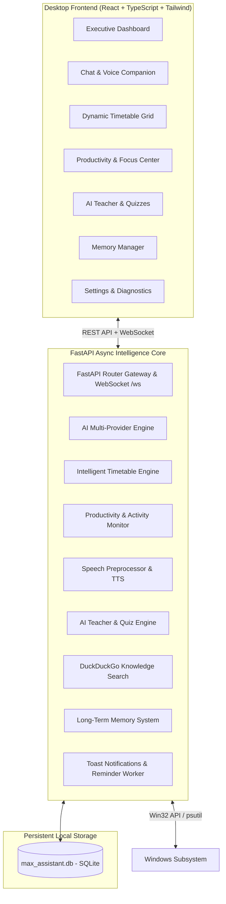

# MAX — My AI eXecutive Assistant 🤖⚡

> **A real, proactive, intelligent desktop AI companion designed to manage your daily timetable, assist learning, monitor productivity with strict privacy, and interact naturally via voice and natural language commands.**

---

## 🌟 Key Highlights & Capabilities

1. **Intelligent Timetable & Dynamic Rescheduling**
   - Automatically builds balanced, non-overlapping schedules based on your goals, deadlines, and working hours.
   - Automatically inserts 15-minute wellness breaks between intense focus blocks.
   - **Dynamic Recalculation via Natural Language**:
     - *"MAX, I need another 30 minutes"* ➔ Extends current block and shifts remaining tasks forward.
     - *"MAX, I need to go outside for 1 hour"* ➔ Inserts personal commitment block right now and reschedules remaining tasks.
     - *"MAX, I completed my coding task"* ➔ Marks task done with 100% progress score and prompts next priority.
     - *"Move chemistry to evening"* ➔ Shifts task and balances remaining daylight hours.

2. **Full Voice Interaction Engine**
   - **Speech-to-Text (STT)**: Direct hands-free voice commands via microphone.
   - **Text-to-Speech (TTS)**: Spoken responses with natural inflection, adjustable speed, and voice selection.
   - **Barge-In / Interruption Support**: One-click interruption or toggle to mute spoken audio at any time.

3. **Privacy-First Productivity & Focus Center**
   - **System Activity Tracking**: Observes active application and window titles to verify focus without invasive tracking.
   - **Idle Time Detection**: Senses absence and initiates intelligent, non-punitive check-ins (*"Are you still studying Python?"*).
   - **Webcam Presence (Strict Opt-In)**: Analyzes basic desk presence completely **in-memory**. **Zero photos or videos are ever saved to disk or uploaded to any server.**
   - **Prominent Emergency Stop Button**: Instantly halts all camera access and activity monitoring immediately.

4. **AI Personal Teacher & Interactive Quiz Engine**
   - Explains complex topics (programming, mathematics, science, AI) using **everyday real-world analogies**, digestible step-by-step breakdowns, and practical code examples.
   - Automatically generates interactive multiple-choice quizzes with instant feedback, scoring, and explanations for every option.

5. **Tool-Based Knowledge Search**
   - Integrates live web search (DuckDuckGo API) with source links and automated synthesis for current factual answers.

6. **Persistent Long-Term Memory System**
   - Remembers user preferences, ongoing projects, long-term goals, routines, and learning history across sessions in local SQLite storage.
   - Full user inspection: search, edit, or delete any memory entry with a single click.

7. **Configurable AI Engine with Offline Fallback**
   - Supports **Google Gemini** (Gemini 2.5 Flash / Pro), **OpenAI**, **Groq**, and **Ollama**.
   - Built-in **Offline Intelligent Heuristic Engine**: MAX functions fully even without an internet connection or external API key!

---

## 🚀 Quick Launch Guide (Windows)

### Option 1: 1-Click Launch (Recommended)
Simply double-click the included batch launcher:
```bat
run_max.bat
```
*This automatically sets up the environment, builds the desktop application, starts the backend core, and opens MAX as a clean, frameless executive desktop app.*

### Option 2: Python Desktop Launcher
From the project root:
```powershell
python launch_max.py
```

### Option 3: Developer Mode
To run the frontend and backend with hot-reloading:

**Terminal 1 (FastAPI Backend Core):**
```powershell
.\.venv\Scripts\activate
uvicorn backend.app.main:app --host 127.0.0.1 --port 8000 --reload
```

**Terminal 2 (React + Vite Desktop UI):**
```powershell
cd frontend
npm run dev
```
Open [http://localhost:3000](http://localhost:3000) in your browser.

---

## ⚙️ Configuration & API Keys

MAX runs **100% offline out of the box** using its built-in rule and heuristic intelligence engine. 

To enable deep AI reasoning with Google Gemini or OpenAI:
1. Open the **Settings** cog in the top-right corner of the MAX application window.
2. Select your provider (**Google Gemini**, **OpenAI**, **Groq**, or **Ollama**).
3. Paste your API key (it is masked and securely stored in your local `.env`).
4. Click **Save Settings**.

Or configure directly in `.env`:
```env
AI_PROVIDER=gemini
AI_MODEL=gemini-2.5-flash
GEMINI_API_KEY=your_gemini_api_key_here
```

---

## 🏗️ System Architecture



---

## 🧪 Testing & Verification

A comprehensive test suite verifies timetable calculations, dynamic natural language rescheduling, command parsing, learning quizzes, and memory persistence:

```powershell
.\.venv\Scripts\python -m unittest backend/tests/test_max_suite.py -v
```

**Test Coverage Summary:**
- `test_01_timetable_generation`: Automatic break insertion, duration math, priority assignment.
- `test_02_dynamic_rescheduling_extend`: Extending active tasks by 30 mins and shifting subsequent tasks.
- `test_03_dynamic_rescheduling_break`: Dynamic outside/errand break insertion.
- `test_04_dynamic_rescheduling_completed`: Marking tasks done via natural language.
- `test_05_command_engine_greetings_and_status`: Current task determination and greetings.
- `test_06_command_engine_remember_fact`: Natural language memory extraction and persistence.
- `test_07_learning_engine_explanation`: Concept breakdown with analogies.
- `test_08_learning_engine_quiz`: Quiz generation and 100% grading verification.
- `test_09_productivity_and_emergency_stop`: Active window tracking and emergency halt.
- `test_10_desktop_diagnostics`: Host CPU, memory, OS, and disk metrics.
- `test_11_voice_cleaner`: Markdown and URL removal for natural speech synthesis.

---

## 🛡️ Security & Privacy Architecture

- **No Secret Webcam Monitoring**: Camera is strictly opt-in, disabled by default, and displays an active animated indicator.
- **Local In-Memory Snapshots**: Camera snapshots are processed in volatile memory only and discarded instantly.
- **Zero Cloud Leakage**: No images, audio files, or personal schedules are transmitted to third parties.
- **Safe Desktop Actions**: MAX never executes destructive terminal commands or system locks without explicit authorization.
- **Emergency Stop Button**: One-click kill switch instantly disables all background monitoring and speech.

---

## 📁 Project Structure

```
├── backend/
│   ├── app/
│   │   ├── config.py             # Environment & system settings
│   │   ├── database.py           # SQLite connection & table initialization
│   │   ├── main.py               # FastAPI server, WebSocket, background worker, static SPA
│   │   ├── models/               # SQLAlchemy models (tasks, memories, logs, chat, quizzes)
│   │   ├── schemas/              # Pydantic schemas
│   │   ├── services/             # Core engines (AI, Timetable, Productivity, Teacher, Memory, etc.)
│   │   └── routers/              # REST API endpoints
│   ├── requirements.txt          # Python dependencies
│   └── tests/
│       └── test_max_suite.py     # Comprehensive automated test suite
├── frontend/
│   ├── src/
│   │   ├── api/client.ts         # Full typed API client
│   │   ├── components/           # Header, Dashboard, Chat, Timetable, Productivity, Teacher, Memory, Settings
│   │   ├── types/index.ts        # TypeScript data models
│   │   ├── App.tsx               # Main application coordinator & WebSocket receiver
│   │   └── main.tsx              # React DOM entry
│   ├── dist/                     # Optimized production bundle
│   ├── package.json
│   └── vite.config.ts
├── run_max.bat                   # 1-Click Windows desktop launcher
├── launch_max.py                 # Cross-platform desktop launcher
├── DEVELOPMENT_STATUS.md         # Milestone tracking
└── .env.example                  # Documented configuration template
```

---

*MAX — Developed as a personal AI executive assistant.*

